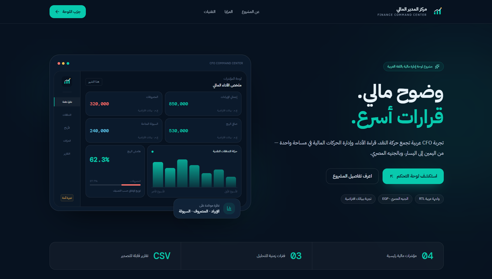
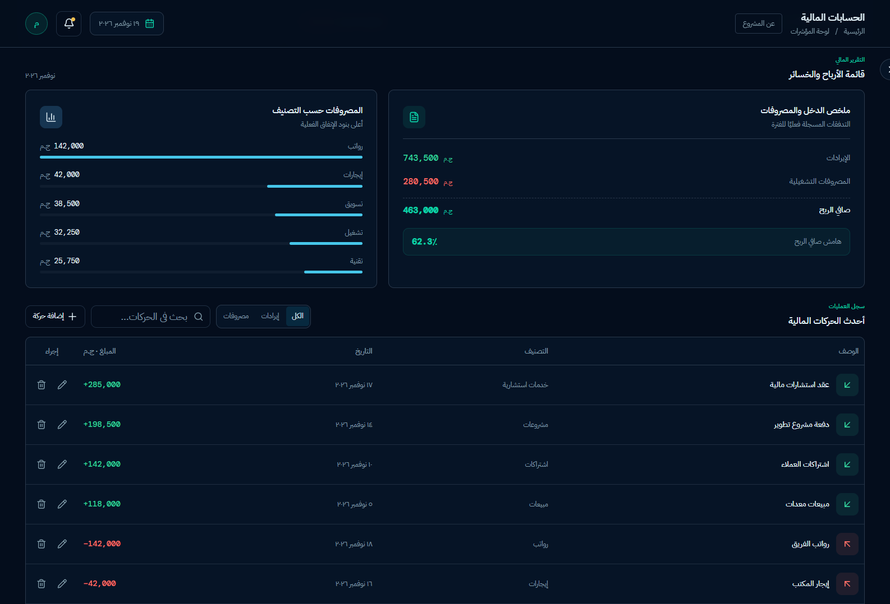

# 💼 مركز المدير المالي | CFO Command Center

**نظام تخطيط وتحليل مالي تنفيذي (FP&A) مصمم بالكامل للشركات في المنطقة العربية باتجاه RTL، يدعم إدارة السيولة، التدفقات النقدية، وقائمة الأرباح والخسائر الفورية.**

[استعراض لوحة التحكم](#-لقطات-النظام--screenshots) • [الميزات الرئيسية](#-الميزات-الرئيسية) • [التقنيات المستخدمة](#-التقنيات-المستخدمة) • [التشغيل المحلي](#-التشغيل-المحلي)

---

## 📸 نظرة عامة على لوحة التحكم

---

## 🌟 الميزات الرئيسية

- **⚡ لوحة مؤشرات فورية (Executive KPIs):** متابعة مستمرة للإيرادات، المصروفات التشغيلية، صافي الأرباح، ونسبة هامش الربح التشغيلي وموقف السيولة بالجنيه المصري (EGP).
- **📈 رسم بياني متقدم للتدفقات النقدية (Cash Flow Trajectory):** مراقبة حركة النقد الفعلي وتحليل الفارق بين التدفقات الداخلة والخارجة شهرياً.
- **📊 تحليل قائمة الدخل (P&L Breakdown):** عرض فوري للإيرادات والمصروفات حسب بنود التشغيل مع كشف هوامش الربحية في كل مرحلة.
- **📑 دفتر الأستاذ وسجل العمليات:** جدول تفاعلي لإضافة، تعديل، وحذف الحركات المالية مع فلترة وتصنيف دقيق وتصدير التقارير.
- **🎨 تجربة مستخدم عربية أصيلة (Native Arabic RTL):** تصميم داكن فائق الدقة مبني على مبادئ التصميم المؤسسي مع دعم كامل للطباعة والشاشات المختلفة.
- **💾 تخزين هجين فائق المرونة:** إمكانية العمل ببيانات تجريبية عبر المتصفح () أو الربط المباشر مع قاعدة بيانات PostgreSQL / Supabase عبر Drizzle ORM.

---

## 🖼 لقطات النظام | Screenshots

### 1. الصفحة التعريفية (Landing Page)
واجهة ترحيبية تشرح قيمة النظام ووضوح الرؤية المالية لاتخاذ القرارات الاستراتيجية.

---

### 2. لوحة المؤشرات الرئيسية (Executive Overview)
مؤشرات الأداء المالي، الرسوم البيانية للتدفق النقدي، وبطاقة التنبيه لموقف السيولة.

---

### 3. ملخص الأرباح والخسائر وجدول العمليات (P&L & Transactions Ledger)
مصفوفة توزيع النفقات والمصروفات وقائمة العمليات المالية مع إمكانية البحث والفلترة.

---

### 4. مزايا وحلول النظام (Enterprise Architecture)
بطاقات توضح تكامل البيانات المالية، الأمان، والسرعة التحليلية.

---

## 🛠 التقنيات المستخدمة (Tech Stack)

| المجال | التقنية | الوصف |
| :--- | :--- | :--- |
| **الواجهة الأمامية** | React 19 + TypeScript | أحدث معايير الأداء وتزامن الواجهات |
| **التوجيه وإدارة الحالة** | TanStack Router & Start | بنية توجيه فائقة السرعة مع دعم SSR |
| **التصميم والتنسيق** | Tailwind CSS v4 + Radix UI | نظام تصميم داكن متناسق مع وصولية كاملة (Accessibility) |
| **الرسوم البيانية** | Recharts | تمثيل بياني تفاعلي وسلس للتدفقات النقدية |
| **قاعدة البيانات** | Drizzle ORM + PostgreSQL / Supabase | مخططات بيانات قوية ومهاجرات SQL موثقة |
| **التحقق والاختبارات** | Vitest + React Testing Library | تغطية اختبارات لوظائف الرياضيات المالية والتوجيه |

---

## 🚀 التشغيل المحلي (Getting Started)

### المتطلبات المسبقة
- **Node.js** (إصدار 20 أو أحدث)
- مدير الحزم المفضّل (npm <command>

Usage:

npm install        install all the dependencies in your project
npm install <foo>  add the <foo> dependency to your project
npm test           run this project's tests
npm run <foo>      run the script named <foo>
npm <command> -h   quick help on <command>
npm -l             display usage info for all commands
npm help <term>    search for help on <term>
npm help npm       more involved overview

All commands:

    access, adduser, audit, bugs, cache, ci, completion,
    config, dedupe, deprecate, diff, dist-tag, docs, doctor,
    edit, exec, explain, explore, find-dupes, fund, get, help,
    help-search, hook, init, install, install-ci-test,
    install-test, link, ll, login, logout, ls, org, outdated,
    owner, pack, ping, pkg, prefix, profile, prune, publish,
    query, rebuild, repo, restart, root, run-script, sbom,
    search, set, shrinkwrap, star, stars, start, stop, team,
    test, token, uninstall, unpublish, unstar, update, version,
    view, whoami

Specify configs in the ini-formatted file:
    /root/.npmrc
or on the command line via: npm <command> --key=value

More configuration info: npm help config
Configuration fields: npm help 7 config

npm@10.9.9 /nix/store/y2i9viwnjc9iwqwcswyd70n88yh7kl60-nodejs-slim-22.23.5-npm/lib/node_modules/npm أو Bun is a fast JavaScript runtime, package manager, bundler, and test runner. (1.4.4+38afee6c8)

Usage: bun <command> [...flags] [...args]

Commands:
  run       ./my-script.ts       Execute a file with Bun
            dev                  Run a package.json script
  test                           Run unit tests with Bun
  check                          Type check a TypeScript project
  fmt                            Format JavaScript and TypeScript, like Prettier
  x         prisma               Execute a package binary (CLI), installing if needed (bunx)
  repl                           Start a REPL session with Bun
  exec                           Run a shell script directly with Bun

  install                        Install dependencies for a package.json (bun i)
  add       @remix-run/dev       Add a dependency to package.json (bun a)
  remove    moment               Remove a dependency from package.json (bun rm)
  update    @evan/duckdb         Update outdated dependencies
  audit                          Check installed packages for vulnerabilities
  dedupe                         Remove duplicate versions from the lockfile
  prune                          Remove packages that are not in the lockfile from node_modules
  outdated                       Display latest versions of outdated dependencies
  link      [<package>]          Register or link a local npm package
  unlink                         Unregister a local npm package
  publish                        Publish a package to the npm registry
  patch <pkg>                    Prepare a package for patching
  pm <subcommand>                Additional package management utilities
  info      @zarfjs/zarf         Display package metadata from the registry
  why       zod                  Explain why a package is installed

  build     ./a.ts ./b.jsx       Bundle TypeScript & JavaScript into a single file

  init                           Start an empty Bun project from a built-in template
  create    elysia               Create a new project from a template (bun c)
  upgrade                        Upgrade to latest version of Bun.

  <command> --help               Print help text for command.

Learn more about Bun:            https://bun.com/docs
Join our Discord community:      https://bun.com/discord)

### خطوات التثبيت

1. **استنساخ المستودع:**
   

2. **تثبيت الاعتماديات:**
   
added 489 packages, and audited 490 packages in 22s

142 packages are looking for funding
  run `npm fund` for details

29 vulnerabilities (1 low, 10 moderate, 17 high, 1 critical)

To address issues that do not require attention, run:
  npm audit fix

To address all issues (including breaking changes), run:
  npm audit fix --force

Run `npm audit` for details.

3. **تشغيل بيئة التطوير:**
   
   افتح المتصفح على:  أو الرابط الموضح في التيرمينال.

---

## 🧪 فحص الجودة والاختبارات

---

## 👨‍💻 المطور
**Yacoub Ashraf**  
- GitHub: [@jacob8110](https://github.com/jacob8110)
