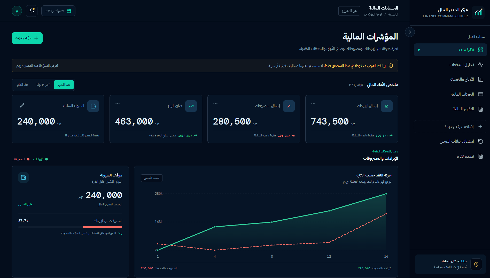
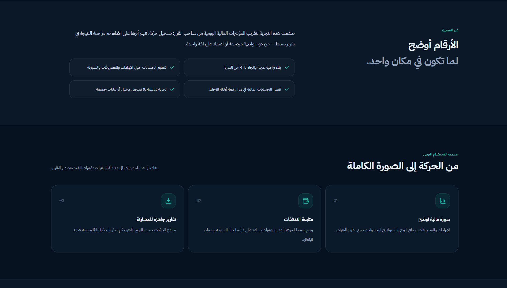

# 💼 مركز المدير المالي | CFO Command Center

<div align="center">

[](https://react.dev/)
[](https://www.typescriptlang.org/)
[](https://tanstack.com/)
[](https://tailwindcss.com/)
[](https://orm.drizzle.team/)
[](https://vitest.dev/)

**نظام تخطيط وتحليل مالي تنفيذي (FP&A) مصمم بالكامل للشركات في المنطقة العربية باتجاه RTL، يدعم إدارة السيولة، التدفقات النقدية، وقائمة الأرباح والخسائر الفورية.**

[استعراض لوحة التحكم](#-لقطات-النظام--screenshots) • [الميزات الرئيسية](#-الميزات-الرئيسية) • [التقنيات المستخدمة](#-التقنيات-المستخدمة) • [التشغيل المحلي](#-التشغيل-المحلي)

</div>

---

## 📸 نظرة عامة على لوحة التحكم



---

## 🌟 الميزات الرئيسية

- **⚡ لوحة مؤشرات فورية (Executive KPIs):** متابعة مستمرة للإيرادات، المصروفات التشغيلية، صافي الأرباح، ونسبة هامش الربح التشغيلي وموقف السيولة بالجنيه المصري (EGP).
- **📈 رسم بياني متقدم للتدفقات النقدية (Cash Flow Trajectory):** مراقبة حركة النقد الفعلي وتحليل الفارق بين التدفقات الداخلة والخارجة شهرياً.
- **📊 تحليل قائمة الدخل (P&L Breakdown):** عرض فوري للإيرادات والمصروفات حسب بنود التشغيل مع كشف هوامش الربحية في كل مرحلة.
- **📑 دفتر الأستاذ وسجل العمليات:** جدول تفاعلي لإضافة، تعديل، وحذف الحركات المالية مع فلترة وتصنيف دقيق وتصدير التقارير.
- **🎨 تجربة مستخدم عربية أصيلة (Native Arabic RTL):** تصميم داكن فائق الدقة مبني على مبادئ التصميم المؤسسي مع دعم كامل للطباعة والشاشات المختلفة.
- **💾 تخزين هجين فائق المرونة:** إمكانية العمل ببيانات تجريبية عبر المتصفح (`localStorage`) أو الربط المباشر مع قاعدة بيانات PostgreSQL / Supabase عبر Drizzle ORM.

---

## 🖼 لقطات النظام | Screenshots

### 1. الصفحة التعريفية (Landing Page)
واجهة ترحيبية تشرح قيمة النظام ووضوح الرؤية المالية لاتخاذ القرارات الاستراتيجية.


---

### 2. لوحة المؤشرات الرئيسية (Executive Overview)
مؤشرات الأداء المالي، الرسوم البيانية للتدفق النقدي، وبطاقة التنبيه لموقف السيولة.


---

### 3. ملخص الأرباح والخسائر وجدول العمليات (P&L & Transactions Ledger)
مصفوفة توزيع النفقات والمصروفات وقائمة العمليات المالية مع إمكانية البحث والفلترة.


---

### 4. مزايا وحلول النظام (Enterprise Architecture)
بطاقات توضح تكامل البيانات المالية، الأمان، والسرعة التحليلية.



---

## 🛠 التقنيات المستخدمة (Tech Stack)

| المجال | التقنية | الوصف |
| :--- | :--- | :--- |
| **الواجهة الأمامية** | React 19 + TypeScript | أحدث معايير الأداء وتزامن الواجهات |
| **التوجيه وإدارة الحالة** | TanStack Router & Start | بنية توجيه فائقة السرعة مع دعم SSR |
| **التصميم والتنسيق** | Tailwind CSS v4 + Radix UI | نظام تصميم داكن متناسق مع وصولية كاملة (Accessibility) |
| **الرسوم البيانية** | Recharts | تمثيل بياني تفاعلي وسلس للتدفقات النقدية |
| **قاعدة البيانات** | Drizzle ORM + PostgreSQL / Supabase | مخططات بيانات قوية ومهاجرات SQL موثقة |
| **التحقق والاختبارات** | Vitest + React Testing Library | تغطية اختبارات لوظائف الرياضيات المالية والتوجيه |

---

## 🚀 التشغيل المحلي (Getting Started)

### المتطلبات المسبقة
- **Node.js** (إصدار 20 أو أحدث)
- مدير الحزم المفضّل (`npm` أو `bun`)

### خطوات التثبيت

1. **استنساخ المستودع:**
   ```bash
   git clone https://github.com/jacob8110/cfo-command-center.git
   cd cfo-command-center
   ```

2. **تثبيت الاعتماديات:**
   ```bash
   npm install
   ```

3. **تشغيل بيئة التطوير:**
   ```bash
   npm run dev
   ```
   افتح المتصفح على: `http://localhost:3000` أو الرابط الموضح في شاشة التيرمينال.

---

## 🧪 فحص الجودة والاختبارات

```bash
# تشغيل جميع الاختبارات المكتوبة
npm test

# فحص كود المشروع والتأكد من المعايير
npm run lint

# بناء نسخة الإنتاج
npm run build
```

---

## 👨‍💻 المطور
**Yacoub Ashraf**  
- GitHub: [@jacob8110](https://github.com/jacob8110)
